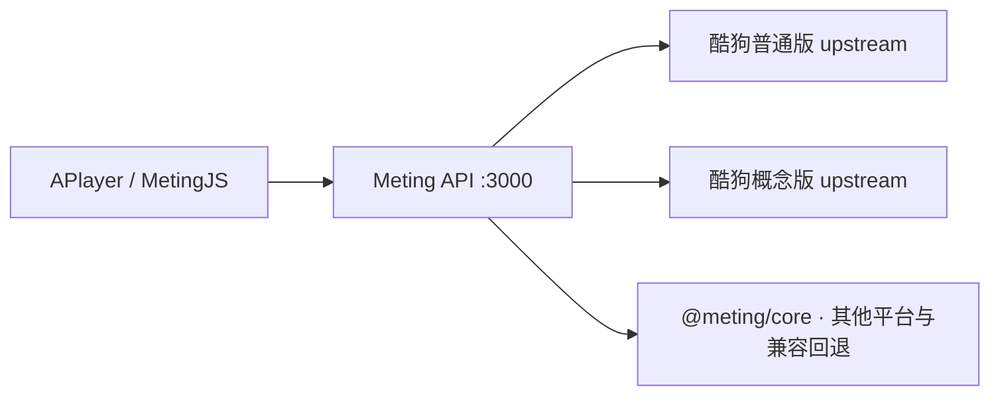

# Meting API · Kugou

面向 APlayer / MetingJS 的音乐 API 服务。在 Meting 多平台接口的基础上，集成酷狗普通版、概念版两个上游，以及账号池管理、登录态刷新和运行监控。

- 保留 `/api`、`/music` 两个兼容入口，返回 `title / author / url / pic / lrc`。
- 酷狗按账号池选择普通版或概念版上游；资源解析失败时回退到 Meting。
- 管理页支持二维码 / 短信登录、Cookie 池维护、刷新和概念版会员领取。
- 提供 Docker Compose 和 PM2 两种部署方式。

## 服务结构



一套部署共三个进程：`meting-api`、`kugou-upstream`、`kugou-upstream-lite`。默认 `premium` 池使用普通版，`general` 池使用概念版；平台通过 `METING_KUGOU_*_PLATFORM` 配置。

## Docker Compose 部署

需要 Docker Engine 和 Compose v2。在仓库根目录执行：

```bash
git clone https://github.com/thekfjie/Meting_Api_Kugou.git
cd Meting_Api_Kugou
cp .env.example .env
```

修改 `.env` 中的 `METING_URL`、`METING_TOKEN`、`ADMIN_PASSWORD` 和 `ADMIN_SESSION_SECRET`，再启动：

```bash
docker compose up -d --build
docker compose ps
curl http://localhost:3000/healthz
```

Windows PowerShell 可用 `Copy-Item .env.example .env` 复制配置。

- API 默认绑定宿主机 `127.0.0.1:3000`，可由同机反向代理对外提供 HTTPS。
- 两个酷狗上游仅在容器网络内通信，不映射宿主机端口。
- `cookies`、`data` 命名卷保存账号池和管理状态。升级使用 `docker compose up -d --build`；保留这两个卷。
- `METING_BIND_PORT` 修改宿主机端口；`METING_URL` 必须填写客户端实际访问的地址。
- `/healthz` 只检查进程存活，账号和播放可用性查看管理页或酷狗监控接口。

查看日志：

```bash
docker compose logs -f --tail=100 meting-api
```

## Node.js / PM2 部署

需要 Node.js 22+、npm；生产环境另需安装 PM2。根项目与 `KuGouMusicApi/` 均使用各自的 `package-lock.json`。

```bash
npm run setup
cp .env.example .env
# 修改 .env 后启动三个进程
pm2 start ecosystem.config.cjs
pm2 save
```

PM2 配置读取根目录 `.env`，两个上游分别监听 `127.0.0.1:3100`、`127.0.0.1:3101`。普通版 / 概念版平台由进程配置固定，不需要反复修改子目录 `.env`。

修改配置后，从仓库根目录重新加载：

```bash
pm2 startOrReload ecosystem.config.cjs --update-env
```

开发时在三个终端分别执行：

```bash
npm run dev
npm run start:upstream
npm run start:upstream:lite
```

## API 使用

两个入口等价：

```text
GET /music?server=kugou&type=song&id=歌曲HASH
GET /api?server=kugou&type=playlist&id=歌单ID
```

| 参数 | 说明 |
| --- | --- |
| `server` | `netease`、`tencent`、`kugou`、`baidu`、`kuwo`；默认 `netease` |
| `type` | `search`、`song`、`album`、`artist`、`playlist`、`lrc`、`url`、`pic`；`songlist` 是 `playlist` 的别名 |
| `id` | 关键词、歌曲 ID / HASH、歌单 ID 等，与 `type` 对应 |
| `auth` / `token` | `url`、`pic`、`lrc` 的资源签名，通常直接使用歌曲结果中生成的链接 |
| `key` | 可选的酷狗 premium 池访问 key，与资源签名密钥独立 |

歌曲和歌单返回播放器可用的 JSON 数组；`url`、`pic` 返回 `302`，`lrc` 返回歌词文本。资源签名为 `HMAC-SHA1(METING_TOKEN, server + type + id)`，酷狗合法的 premium key 也可用于资源鉴权。

酷狗返回仅支持 HTTP 的音频时，播放链接会重定向到同站的签名流式接口，经 API 转发音频并保留 Range / 206，供 HTTPS 页面播放；不会把不支持 HTTPS 的 CDN 地址直接改写。

酷狗上游目前覆盖 `song / playlist / lrc / url / pic`。`search / album / artist`、游客线路和其他平台继续使用 `@meting/core`；这些接口的实际可用性取决于对应平台。分享歌单保留独立解析链路。

## 管理与监控

| 地址 | 用途 |
| --- | --- |
| `/music/manage/login` | 管理页登录；也支持 `/api/manage/login` |
| `/music/manage` | 账号池、登录、刷新、领取与运行状态 |
| `/music/manage/monitor` | 公开监控页；也支持 `/api/manage/monitor` |
| `/monitor/kugou` | 酷狗状态 JSON；也支持 `/api/monitor/kugou` |
| `/healthz` | 无外部请求的进程存活探针 |

账号登录后写入文件池。**环境变量 Cookie 优先于文件池**；使用管理页维护账号时，应清空对应的 `METING_COOKIE_KUGOU*` 环境变量。

服务内置定时调度：有 Cookie 的文件池会安排登录态刷新；开启 `AUTO_CLAIM` 的概念版池会安排会员领取，结果及下次执行时间保存在管理状态中。领取能否成功取决于账号资格和上游返回，手动按钮仍可使用。

## 开发与文档

```bash
npm run lint
npm test
```

测试使用本地模拟上游，隔离 `.env`、Cookie 和管理状态，不调用真实账号登录、刷新或领取接口。CI 在 Node.js 22 / 24 上执行检查，随后构建 API / upstream 两种目标的 amd64、arm64 镜像；PR 只构建，主分支与版本标签可发布到 GHCR。

- [配置、账号池与故障排查](docs/configuration.md)
- [酷狗上游说明](KuGouMusicApi/README.md)
- [酷狗底层接口文档](KuGouMusicApi/docs/README.md)

## 项目来源

本项目基于 [Meting](https://github.com/metowolf/Meting) 的接口与 `@meting/core`，内置上游来自 [KuGouMusicApi](https://github.com/MakcRe/KuGouMusicApi)。上游原有版权及许可保留在依赖包和 `KuGouMusicApi/LICENSE` 中。
